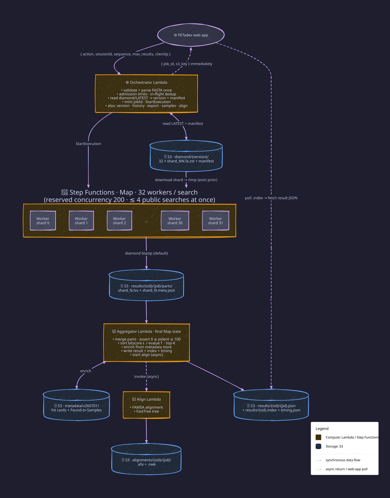

<p align="center">
  
</p>

<h1 align="center">PETadex Sequence Search</h1>

<p align="center"><b>DIAMOND-powered protein search across the 299M-sequence PETadex v260701 catalytic corpus</b></p>

> **Note: This is an internal component, not a standalone tool. It is designed to be invoked as an AWS Lambda function by the PETadex web application.**

**DIAMOND2-powered** protein sequence similarity search against the PETadex **v260701** release: 298,687,346 full-length catalytic proteins (PAZy 486, NCBI nr 6,764,617, Logan 291,922,243). The database is split into 32 zstd-compressed FASTA shards searched in parallel by fan-out worker Lambdas, coordinated by AWS Step Functions. Hits are enriched from a metadata store, and every search gets a background alignment and tree. Packaged as one Docker image that runs as AWS Lambda functions or a standalone CLI.

> **Status:** live since 2026-06-03. Current database `petadex_seq_v260701_20261026_202443` (since 2026-10-27), `search_version` 1.6.0, about 47–50 s per search end to end. History: [docs/cutover.md](docs/cutover.md).

---

## Architecture



| Component | Function | Role |
|---|---|---|
| **Orchestrator** | `petadex-diamond-orchestrator` | Validates the query once, applies public-search limits and in-flight dedup, pins `diamond/LATEST`, starts the execution and returns `{job_id, s3_key}` immediately. Also serves `export`, `history`, `version`, `samples` and `align`. |
| **State machine** | `petadex-diamond-search` | Step Functions `Map`: one worker per shard, per-branch retry, any failure fails the whole job (fail-fast), then the aggregator. |
| **Worker** ×32 | `petadex-diamond-worker` | Downloads its `.fa.zst` shard to `/tmp`, runs `diamond blastp` with corpus-wide `--dbsize`, writes a TSV part. |
| **Aggregator** | `petadex-diamond-aggregator` | Merges parts, ranks by bitscore, keeps the top 500, enriches from the metadata store, writes the result JSON + `.index`, starts the align Lambda. |
| **Align** | `petadex-diamond-align` | FAMSA alignment + FastTree tree of the query and selected hits. Runs after the result is written; never blocks or fails a search. |

The four Lambdas share **one ARM64 image** (DIAMOND 2.2.2 built from source with zstd, FAMSA 2.5.2, FastTree 2.2.0); each picks its handler with `ImageConfig.Command`.

### Why these choices

| Decision | Choice | Rationale |
|---|---|---|
| Engine | **DIAMOND2** (`blastp`, default sensitivity) | The Logan corpus was built with DIAMOND2. Parity with MMseqs2 was validated at `--very-sensitive`; the live search runs default mode, a recall-for-speed trade (2026-06-04). |
| Storage | **S3, sharded** (not EFS) | The 24 GiB sharded DB costs well under $1/mo on S3 vs ~$60/mo flat on EFS; a shard downloads in ~8 s. |
| Compute | **Lambda fan-out** | No idle cost; 32 shards searched in parallel. |
| Coordination | **Step Functions Map** | Declarative per-shard retry and catch. |
| Partial failures | **Fail-fast** | A partial corpus search isn't reproducible, so any shard failing after retries fails the job. |

---

## Documentation

| Topic | Where |
|---|---|
| Lambda API (`search`, `export`, `history`, `version`, `samples`, `align`), request lifecycle | [src/README.md](src/README.md#lambda-api) |
| Result S3 layout, result and timing schemas | [src/README.md](src/README.md#result-s3-layout--contract) |
| Versioning and the web-app cache key | [src/README.md](src/README.md#versioning--cache-invalidation) |
| Result depth, export of all hits, metadata enrichment, Found in Samples, alignment + tree | [src/README.md](src/README.md#result-depth--variable-display-count) |
| Public-search limits and alarms, scoring and e-values, failure policy, input validation | [src/README.md](src/README.md#public-search-limits--alarms) |
| Lambda configuration, deployment, provisioning, S3 lifecycle | [infra/README.md](infra/README.md) |
| Database layout, building and publishing a version, all scripts | [scripts/README.md](scripts/README.md) |
| Tests and fixtures | [tests/README.md](tests/README.md) |
| Cutover history, legacy MMseqs2 path | [docs/cutover.md](docs/cutover.md) |

---

## Quick start

**Deploy:** push to `main`. [deploy.yml](.github/workflows/deploy.yml) builds the arm64 image (~5 min), updates all four functions, then regenerates the example searches. Put `[skip ci]` in the commit message for docs-only changes. Details: [infra/README.md](infra/README.md).

**Search locally** (same DIAMOND call and parser as production, no AWS):
```bash
docker build -t petadex-search .
docker run --rm -v $PWD:/work --entrypoint python3 \
  petadex-search cli.py --db /work/mydb.fa.zst --max-results 10 "MKLLIVLLALAVAALHAQQGVGAPVP"
```

**Test:** `.venv/bin/python tests/test_<name>.py` (see [tests/README.md](tests/README.md)).

---

## Project structure

```
petadex-sequence-search/
├── src/          # Lambda code: orchestrator, worker, aggregator, align, metadata, common, cli
├── infra/        # State machine, IAM policies, alarm relay, architecture diagram
├── scripts/      # db/ builds, deploy/ provisioning + validation, bench/, ops/ alarms
├── tests/        # Script tests + real fixtures
├── docs/         # cutover.md, publishing.md
├── data/         # Example sequences, regenerated on every deploy
├── docker/       # Dev-build worker image
├── assets/       # Logo + social preview
└── Dockerfile    # ARM64 Lambda image
```

---

## Tech stack

- **Search**: DIAMOND 2.2.2 `blastp` (source-built with zstd) · **Alignment/tree**: FAMSA 2.5.2 + FastTree 2.2.0
- **Runtime**: Python 3.11 on AWS Lambda ARM64 (Graviton)
- **Coordination**: AWS Step Functions (`Map` fan-out), plus an async align Lambda
- **Storage**: Amazon S3 (`petadex` bucket): sharded `.fa.zst` database, metadata + samples stores, results, exports, alignments
- **Ops**: CloudWatch alarms → SNS → ntfy
- **CI/CD**: GitHub Actions → ECR → Lambda
