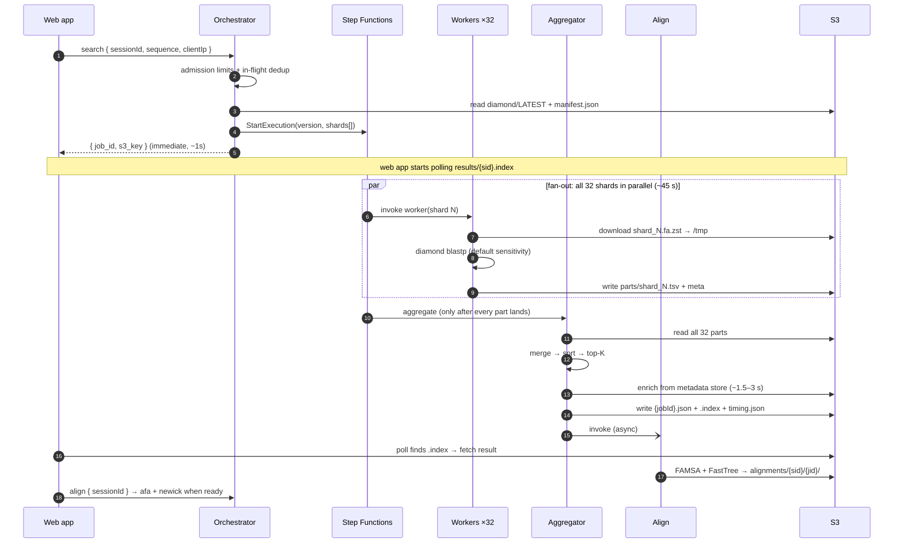

# Search runtime (`src/`)

The Lambda code, its API and its data contracts. One ARM64 image holds all of it; each function picks its handler with `ImageConfig.Command` (`orchestrator.handler` / `worker.handler` / `aggregator.handler` / `align.handler`). Files are copied flat into the task root, so handler names carry no `src.` prefix. Overview and diagram: [main README](../README.md).

| File | Role |
|---|---|
| [orchestrator.py](orchestrator.py) | Validates the query, admission + in-flight dedup, pins `diamond/LATEST`, starts the Step Functions execution; also the `export`, `history`, `version`, `samples` and `align` actions |
| [worker.py](worker.py) | Downloads one shard to `/tmp`, runs `diamond blastp`, writes a TSV part |
| [aggregator.py](aggregator.py) | Merges parts → ranks → top-K → enriches → writes result + `.index` + `timing.json`; starts the align Lambda |
| [metadata.py](metadata.py) | Hit cards and summary from the metadata store; Found-in-Samples lookups |
| [align.py](align.py) | FAMSA alignment + FastTree tree for a result |
| [common.py](common.py) | FASTA parse/validate, `SEARCH_VERSION`, `RESULT_DEPTH`, export constants |
| [cli.py](cli.py) | Local search against any `.dmnd` / FASTA / `.fa.zst`, same DIAMOND call and parser as production |

**Contents:** [Request lifecycle](#request-lifecycle) · [Lambda API](#lambda-api) · [Result S3 layout](#result-s3-layout--contract) · [Versioning](#versioning--cache-invalidation) · [Schemas](#result-and-timing-schemas) · [Result depth](#result-depth--variable-display-count) · [Export](#export-of-all-significant-hits) · [Metadata](#metadata-enrichment) · [Alignment](#alignment-and-tree) · [Limits](#public-search-limits--alarms) · [Scoring](#scoring--e-values) · [Worker cache](#warm-cache-cold-starts--the-download-lever) · [Failure policy](#failure-policy-fail-fast) · [Input validation](#input-validation) · [Running locally](#running-locally)

## Request lifecycle

**Temporal view.** The orchestrator returns *before* the search runs; the aggregator publishes the result minutes later, and the web app bridges the gap by polling:



## Lambda API

The web app invokes the **orchestrator** (`petadex-diamond-orchestrator`), which accepts seven actions via the event body: `search`, `export`, `history`, `version`, `samples`, `align` (below; `samples` and `align` are detailed under [Metadata enrichment](#metadata-enrichment) and [Alignment and tree](#alignment-and-tree)). The contract is unchanged from the legacy path, so callers needed only a function-name swap.

**Search**: validates the query, starts the Step Functions execution, and returns immediately (the aggregator publishes the result minutes later; the caller polls `results/{sessionId}.index`):
```json
{
  "action": "search",
  "sessionId": "abc123",
  "sequence": "MKLLIVLLAACLAVFAAAEPQIAVV",
  "max_results": 50,
  "clientIp": "203.0.113.7"
}
```

> `clientIp` is optional; when present the request goes through [admission](#public-search-limits--alarms) (429 / 503 on refusal), and a duplicate of a running search returns that job with `"deduped": true`.
>
> `max_results` is accepted but **presentational only**: every job searches to the fixed `RESULT_DEPTH` (see [Result depth](#result-depth--variable-display-count)) and the caller subsets at view time. It is not part of the cache key and does not change what is searched or stored.

Response:
```json
{
  "job_id": "550e8400-e29b-41d4-a716-446655440000",
  "s3_key": "results/abc123/550e8400-e29b-41d4-a716-446655440000.json"
}
```

**Export**: every significant hit for a query (e ≤ 1e-3, no hit cap), on demand. Same request as a search, with the search's `sessionId` (cache key). If a finished export exists it comes back as `ready`; otherwise the uncapped fan-out starts and the response is `running`, with the same admission limits and in-flight dedup as a search:
```json
{
  "action": "export",
  "sessionId": "abc123",
  "sequence": "MKLLIVLLAACLAVFAAAEPQIAVV"
}
```

Response (`running`; poll `s3_key` like a search, or `results/{export_session_id}.error` on failure):
```json
{
  "status": "running",
  "job_id": "…",
  "s3_key": "results/abc123_x/….json",
  "export_session_id": "abc123_x"
}
```
Response (`ready`; the caller reads the summary and presigns `hits_key`; the orchestrator can list but not read results):
```json
{
  "status": "ready",
  "job_id": "…",
  "s3_key": "results/abc123_x/….json",
  "hits_key": "results/abc123_x/…/hits.tsv.gz",
  "export_session_id": "abc123_x"
}
```
See [Export of all significant hits](#export-of-all-significant-hits) for the files.

**History:**
```json
{
  "action": "history",
  "sessionId": "abc123"
}
```

Response:
```json
{
  "history": [
    { "job_id": "...", "s3_key": "...", "last_modified": "...", "size": 1234 }
  ]
}
```

**Version**: stateless; returns the corpus + pipeline versions a fresh search would run with, so the web app can build a version-aware cache key (see [Versioning & cache invalidation](#versioning--cache-invalidation)). Takes no `sessionId`:
```json
{
  "action": "version"
}
```

Response:
```json
{
  "database_version": "petadex_seq_v260701_20261026_202443",
  "database_release": "v260701",
  "search_version": "1.6.0",
  "result_depth": 500
}
```

## Result S3 layout & contract

The **contract is unchanged** from the legacy path, so the web app needs only a function-name swap:

```
results/{sessionId}.index                          # 36-byte pointer: the jobId
results/{sessionId}/{jobId}.json                   # final result (schema below)
results/{sessionId}/{jobId}/parts/shard_N.tsv      # raw worker outputs (aggregator input)
results/{sessionId}/{jobId}/parts/shard_N.meta.json# per-shard timing sidecar
results/{sessionId}/{jobId}/timing.json            # job-level timing rollup
```

The result JSON keeps `{ query_header, query_sequence, query_length, num_results, results[] }` (each hit: `target_id, query_start, query_end, target_start, target_end, alignment_length, percent_identity, evalue, bitscore, target_sequence, btop, metadata`), plus **additive identity stamps** the web app may ignore or render: `engine` (`diamond`), `database`, `database_release`, `database_version`, `search_version`, `result_depth`, `db_sequence_count`. Since `search_version` 1.5.0 each hit's `metadata` is its card from the metadata store (see [Metadata enrichment](#metadata-enrichment)), and the result adds `enrichment_status`, `metadata_version`, `clusters` and `summary`; since 1.6.0 each hit also carries `btop` (its alignment, below).

Two JSON objects are written per job: the **search result** (`{jobId}.json`) and a separate **timing diagnostic** rollup (`{jobId}/timing.json`). Both schemas are below.

## Versioning & cache invalidation

Every search is labelled by **two independent version axes**, both stamped into the result JSON, so a cached result is never silently served against a corpus or a search pipeline it wasn't produced with:

| Axis | Result field(s) | What it tracks | Changes when |
|---|---|---|---|
| **Database** | `database_release` (`v260701`, human label) + `database_version` (`petadex_seq_v260701_20261026_202443`, precise build tag) | The corpus searched against. `database_release` is parsed from the corpus filename (`PETadex.seq.v260701.fa`) and labels every shard via the manifest; `database_version` pins the exact build. | The corpus is rebuilt/republished (new data, re-sharding). `database_version` changes on *every* rebuild; `database_release` only on a new release (`v1.1` → `v260701`). |
| **Search** | `search_version` (`1.6.0`, semver) | The search pipeline: engine, sensitivity flag, block size, scoring/`--dbsize` calibration. Defined as the `SEARCH_VERSION` constant in [common.py](common.py) and bumped by hand. | The search changes results for the *same* query against the *same* corpus, e.g. the sensitivity switch (`--very-sensitive` → default), an engine swap, a scoring change, or a payload change (1.5.0 metadata store, 1.6.0 `btop`). |

Both axes are needed because either one alone leaves a staleness hole: a corpus bump invalidates results the database axis catches, but a pipeline change (same corpus, different sensitivity) is invisible to it, and that's what `search_version` covers.

**Cache key (web-app responsibility, now implemented).** The Express app (`petadex.io`) derives `sessionId` by hashing the query **plus both versions**, so a corpus or pipeline change produces a fresh key (cache miss → re-run) instead of serving a stale result. The live key is:

```
sessionId = md5(cleanSequence + ":" + database_version + ":" + search_version)
```

Use `database_version` (the precise build tag), not `database_release`, so the cache also invalidates on a same-release rebuild. The key was previously `hash(sequence)` only; folding in the versions re-keyed the entire prior keyspace at once (a one-time full cache miss), orphaning every pre-versioning result tree.

The key must encode the versions a *fresh* search **would** run with (current corpus + pipeline), so the web app needs to learn them *before* the cache-hit decision, not read them off a stale entry. `database_version` is `diamond/LATEST`, but `search_version` is a code constant (`SEARCH_VERSION` in [common.py](common.py)) that lives nowhere in S3. So the orchestrator exposes a stateless **`version` action** as the single source of truth:

```jsonc
// request:  { "action": "version" }   (no sessionId: it's what you call to BUILD one)
// response: { "database_version": "petadex_seq_v260701_20261026_202443",
//             "database_release": "v260701", "search_version": "1.6.0",
//             "result_depth": 500 }
```

The web app calls this (cache the response briefly), folds the two versions into `makeSessionId`, then does its normal index lookup. **The `makeSessionId` change lives in the Express web-app repo (`petadex.io`), not here.** This repo's job is to make the versions *self-describing* (stamped into every result) and *queryable* (the `version` action) so the key can be built. Re-keying orphans every prior cache entry; the orphaned `parts/` and `timing.json` are reaped by the `reapable=true` lifecycle rule (see [Cleanup & lifecycle](../infra/README.md#cleanup--lifecycle)), while the small leftover `{jobId}.json` + `.index` are negligible.

### Known fragilities (operational caveats)

The architecture is sound: two orthogonal axes, version pinned once per job, results self-describing. The exposure is in two **manual tripwires**, not the design:

1. **`search_version` is hand-bumped; nothing couples it to the actual search parameters.** If a change to sensitivity, block size, scoring, or the engine is shipped without bumping `SEARCH_VERSION` in [common.py](common.py), the cache silently serves stale results for the same query, the exact failure this scheme exists to prevent, with no automated guard. Treat bumping `SEARCH_VERSION` as part of any change to the DIAMOND command or its calibration. (A hardening option: derive `search_version` from a hash of the live params (`engine|sensitivity|block_size|dbsize_mode`) so it cannot drift.)
2. **The cache key depends on the live `version` action, and the web app's failure handling must reach a *unique* fallback.** The key's `database_version` comes from calling `version` before the cache-hit decision. If that lookup fails, the web app must fall back to a **per-request nonce** (forcing a clean miss), *not* an empty-version key; otherwise all failing requests collide on one `…::` key and can serve each other stale results. Note the orchestrator returns handled errors as `{statusCode, body:{error}}` with **no Lambda `FunctionError`**, so the web-app guard must treat a non-2xx envelope (or missing version fields) as failure, not just a thrown SDK error. (This guard lives in `petadex.io`.)

Two benign properties, noted so they aren't mistaken for bugs:

- **Rebuild-window TOCTOU.** If `LATEST` flips between the web app's `version` call and the orchestrator's own `resolve_version`, the result is stamped/run under the newer build but stored under the older-version key. Harmless: once `LATEST` advances, new lookups build the new key and never revisit the old one. Worst case is one redundant re-run right after a rebuild.
- **No result archival.** The `jobId` *is* the result version, and `results/{sessionId}.index` points only to the newest. Older versions for the same key are immutable orphans until reaped; you can list them via `history` but cannot pin/serve a specific historical one. This is a cache, not an archive.

## Result and timing schemas

### Result JSON schema (`results/{sessionId}/{jobId}.json`)

**Top-level (job metadata):**

| Field | Type | Description |
|---|---|---|
| `query_header` | string | User-supplied label identifying the search (free text; defaults to `query`). |
| `query_sequence` | string | The input amino-acid sequence that was searched. |
| `query_length` | int | Length of the query in residues. |
| `num_results` | int | Number of hits actually found and stored (equals `len(results)`). Capped by `result_depth`; when it is **less**, the e-value floor was reached first, so the search was exhaustive. |
| `result_depth` | int | **Depth this job searched to**: the per-shard `-k` and the final truncation limit (`RESULT_DEPTH` in [common.py](common.py)). A cached result can serve any display count up to this; a deeper request must re-run. Added in `search_version` 1.4.0. See [Result depth](#result-depth--variable-display-count). |
| `engine` | string | Search engine, always `diamond` on this path. |
| `database` | string | S3 path of the source corpus FASTA the shards were built from (`s3://petadex/diamond/corpus/PETadex.seq.v260701.fa`). |
| `database_release` | string \| null | **Human-facing corpus version**, e.g. `v260701` (earlier `v1.1`) (parsed from the corpus filename). The display label for "which database." `null` if the corpus name carries no `vN` token. See [Versioning & cache invalidation](#versioning--cache-invalidation). |
| `database_version` | string | **Precise build tag** of the corpus (e.g. `petadex_seq_v260701_20261026_202443`). Pins the result to one exact build of a release and changes on *every* rebuild, even within the same `database_release`. This is the corpus identifier the cache key should use. |
| `search_version` | string | **Search-pipeline version** (semver, e.g. `1.6.0`), independent of the corpus. Bumps when the search itself changes results for the same query against the same corpus (engine, sensitivity, block-size, scoring). See [Versioning & cache invalidation](#versioning--cache-invalidation). |
| `db_sequence_count` | int | **Sequence** count across all shards (298,687,346). This is the corpus size for reference; it is *not* the e-value `--dbsize`, which is a **residue** count (88.18B residues ≈ 295.2 × 298,687,346 sequences; see Scoring & e-values). |
| `enrichment_status` · `metadata_version` · `clusters` · `summary` | | Metadata-store enrichment (1.5.0+); see [Metadata enrichment](#metadata-enrichment). |
| `results` | array | Hit list, ranked by bit-score descending, then e-value ascending. |

**Per-hit object (each element of `results`):**

| Field | Type | Description |
|---|---|---|
| `target_id` | string | Identifier of the matched DB sequence: the corpus's native FASTA header, passed through unchanged (a `petadex_id` since v260701). Pipe-delimited; see format below. |
| `query_start` | int | Alignment start on the query (1-based, inclusive). |
| `query_end` | int | Alignment end on the query (1-based, inclusive). |
| `target_start` | int | Alignment start on the target (1-based, inclusive). |
| `target_end` | int | Alignment end on the target (1-based, inclusive). |
| `alignment_length` | int | Length of the aligned region in residues. |
| `percent_identity` | float | Percent identical residues over the alignment, **0–100** (DIAMOND's native scale; never re-scaled; see Scoring & e-values). |
| `evalue` | float | Expectation value, calibrated against the **full corpus** (not the local shard) via `--dbsize`. |
| `bitscore` | float | DIAMOND bit-score. **Primary ranking key.** |
| `target_sequence` | string \| null | **Full amino-acid sequence of the matched target** (DIAMOND's `full_sseq`): the complete subject protein, not just the aligned segment, so it is typically longer than `alignment_length`. Added in `search_version` 1.3.0; `null` only for a hit merged from a part written by an older worker. |
| `btop` | string | DIAMOND's Blast trace-back over `query_start`–`query_end` / `target_start`–`target_end` (1.6.0+): a number = that many identical residues, a letter pair = query then target residue at a mismatch, `-` = gap. A target letter may read `X` where DIAMOND masked a low-complexity stretch; take the residue from `target_sequence`. ISPETase: 500/500 hits rebuild exactly; ~80 KB per 500 hits. |
| `metadata` | object \| null | The hit's card from the metadata store (1.5.0+; see [Metadata enrichment](#metadata-enrichment)); `null` when the id isn't in the store. |

Coordinates follow DIAMOND's outfmt-6 default: **1-based, inclusive** on both query and target.

**`target_id` format.** The build script (`scripts/db/build_diamond_shards.py`) keeps each record's **native corpus header** verbatim as the sequence ID; it does *not* synthesize or define this convention, which originates upstream in the Logan catalytic-ORF corpus. Observed IDs are pipe-delimited with **7 fields**, falling into two provenance types:

| Field | Reference/structural hit | Logan metagenomic hit |
|---|---|---|
| | `1\|WP_054022242.1\|\|\|\|\|` · `4065673\|6EQD_A\|\|\|\|\|` | `610376058\|\|SRR15056541\|5882\|0\|933\|3` |
| 1 | numeric ID (always present) | numeric ID (always present) |
| 2 | reference accession: GenBank protein (`WP_054022242.1`) or PDB (`6EQD_A`) | *(empty)* |
| 3 | *(empty)* | SRA run accession (`SRR…`/`ERR…`) |
| 4–7 | *(empty)* | numeric metagenomic coordinates (contig/ORF locus, start, end, frame/strand) |

> ⚠️ Fields 4–7 are **not authoritatively defined in this repo**: the build script is a passthrough, so their exact meaning must be confirmed against the upstream Logan corpus specification before relying on them. Consumers should treat the whole `target_id` as an opaque key and split it only for display.

**v260701 ids.** Since v260701 the corpus headers are bare `petadex_id`s whose prefix gives the origin: `PL…` Plasticome (PAZy), `NR…` NCBI nr, `LG…` Logan. The 7-field format above applies to v1.1 results.

### Timing diagnostic schema (`results/{sessionId}/{jobId}/timing.json`)

A side-car rollup written **beside** the result (not inside it), so it survives the fail-fast path and needs no contract change.

**Top-level:**

| Field | Type | Description |
|---|---|---|
| `job_id` | string (uuid) | Unique search job identifier. |
| `session_id` | string | Session/run label (e.g. `regen_example_fast_petase`). |
| `version` | string | Corpus build version (matches `database_version`). |
| `status` | string | `success` or `failed`. |
| `submitted_at` | string (ISO 8601) | Job submission timestamp (start of the wall clock). |
| `completed_at` | string (ISO 8601) | Rollup-write timestamp. |
| `total_wall_ms` | float \| null | End-to-end wall time from `submitted_at`, in ms. |
| `shard_count` | int | Number of shards the corpus is split into (32). |
| `shards_expected` | int | Shards the job expected to report. |
| `shards_completed` | int | Shards that completed successfully. Equality with `shards_expected` is the fail-fast completeness check. |
| `slowest_shard_ms` | float \| null | Max per-shard `total_ms` (≈ `total_wall_ms`). |
| `fastest_slowest_spread_ms` | float \| null | Spread between fastest and slowest shard (the load-balance metric). |
| `orchestrator` | object \| null | Orchestrator pre-start phase timings (`parse_ms`, `resolve_version_ms`, `load_shards_ms`, `total_pre_start_ms`). |
| `aggregator` | object \| null | Aggregator post-Map phase timings (below); `null` on the failure path. |
| `shards` | array | Per-shard timing records, sorted by `shard_index`. |

**`aggregator` object:**

| Field | Type | Description |
|---|---|---|
| `read_parts_ms` | float | Time reading + parsing all shard parts from S3. |
| `sort_ms` | float | Time for the global bitscore/evalue ranking + top-K. |
| `metadata_ms` | float | Time for the metadata-store enrichment (~3.1–3.3 s live). |
| `write_result_ms` | float | Time writing the combined result + `.index` to S3. |
| `total_ms` | float | Sum of the aggregator phases. |

**Per-shard object (each element of `shards`):**

| Field | Type | Description |
|---|---|---|
| `shard_index` | int | Shard identifier (0–31). |
| `download_ms` | float | Time to download the shard to `/tmp` (~8 s for a ~779 MB `.fa.zst`; 0 on a warm cache hit). |
| `search_ms` | float | Time for `diamond blastp` on this shard. |
| `total_ms` | float | Download + search for this shard. |
| `shard_size_bytes` | int | Size of the shard file (~779 MB per v260701 `.fa.zst`). |
| `shard_seq_count` | int | Sequences in this shard (~9.33M each in v260701). |
| `num_hits` | int | Hits this shard contributed before the global merge. |
| `status` | string | Per-shard status (`success` / `failed` / `missing`). |
| `error` | string \| null | Error message if the shard failed; `null` on success. |
| `timestamp` | string (ISO 8601) | Shard completion time. |

A shard whose worker died before writing its sidecar appears as `{ "shard_index": i, "status": "missing" }` rather than being dropped.

**Notes from observed data (v1.1, 20 `.dmnd` shards, before 2026-06-26).** Shards are near-perfectly even: every shard holds 15,357,787–15,357,788 sequences and ~6.017 GB, confirming the round-robin partition balances both seq count and residues (20 × ~15.357M = the 307,155,746 corpus total). Per-shard `download_ms` is uniform (~77–78 s, the Lambda network ceiling), so the `fastest_slowest_spread_ms` comes entirely from `search_ms`, which clusters into two bands (~29 s and ~37–38 s). The bimodality is not explained by sequence count (identical across shards) and is attributed to **Lambda vCPU allocation variance** (cold-vs-warm CPU), a known, benign source of the ~9–10 s spread. *(v260701: 32 shards of 9,333,979–9,333,980 sequences and ~2.756 G residues each; download ~8 s.)*

## Result depth & variable display count

Every job searches to a **fixed server-side depth** (`RESULT_DEPTH` in [common.py](common.py), currently **500**) regardless of how many hits the caller asks to display. The request's `max_results` is accepted (the contract is unchanged) but is **presentational only**: it never reaches DIAMOND, never changes what is stored, and is **not part of the cache key**.

**Why.** `max_results` used to be both a search parameter (`-k` per shard, then the aggregator's truncation) *and* a cache-key input. So changing a displayed count produced a different `sessionId` → cache miss → a full 32-shard fan-out (~46 s, 32 Lambda invocations) to surface rows the previous job had **already computed and discarded** at the truncation step. The fan-out's cost is fixed (shard download plus seed-index rebuild) and is essentially independent of `-k`, so searching deep once and subsetting at view time is far cheaper than re-searching.

**The subset is exact, not an approximation.** Per-shard `-k K` followed by a global merge yields the true global top-K (a hit in the global top-K necessarily ranks at least as high within its own shard), and that invariant holds for **every N ≤ K**. The first N rows of a stored depth-K result are identical to what a fresh `max_results=N` search would have produced.

**Depth is a ceiling, not a quota.** The worker passes no `--evalue`, so DIAMOND's default `1e-3` cutoff applies, and full-corpus `--dbsize` calibration makes e-values *less* significant than a per-shard run would, so that cutoff usually bites first. Most queries return fewer hits than `RESULT_DEPTH`.

**How a consumer uses it.** Every result stamps `result_depth` alongside `num_results`:

| Observation | Meaning |
|---|---|
| `requested N <= result_depth` | Serve from cache: slice the stored `results[]` to N. |
| `requested N > result_depth` | **Cache miss**: re-run (the stored result is too shallow). |
| `num_results < result_depth` | The e-value floor was reached first: the search was **exhaustive**, so *every* display count is servable from this result, forever. |

The `version` action reports the depth a *fresh* search would use, so the app can make this decision before the cache lookup rather than reading it off a stale entry.

> **Changing `RESULT_DEPTH` does not require a `SEARCH_VERSION` bump.** Because each result carries its own `result_depth`, raising the constant re-runs only those queries whose stored depth is too shallow, instead of busting the whole cache. (The 1.3.0 → 1.4.0 bump was needed for the one-time *switch* to fixed-depth searching, not for future depth changes.)
>
> **Never set it to 0 / unlimited.** Against a 299M-sequence corpus a promiscuous query would produce an unbounded payload, and since 1.3.0 every hit carries a full protein sequence (~586 B/hit, so ~293 KB at depth 500). Uncapped results exist only as the on-demand, sequence-free [export](#export-of-all-significant-hits).

**The display-side subsetting lives in `petadex.io`, not here.** This repo's job is to search deep, store the depth, and report it. ⚠️ In the Express app the slice must happen **before** `enrichWithFamilyData()`, otherwise that per-request Postgres round trip runs over the full stored depth instead of the displayed count.

## Export of all significant hits

The search stops at `RESULT_DEPTH` per shard, so DIAMOND never computes the rest. Measured on one v260701 shard and scaled to the corpus, a query has ~31k (SRR10663367) to ~7.9M (a C003 query) hits at e ≤ 1e-3, so "all hits" can't be part of every search. The `export` action re-runs the fan-out with no cap, on demand:

- **No state-machine change.** It rides `maxResults = 0` (`common.EXPORT_DEPTH`, DIAMOND's `-k 0` = no limit) through the existing Map; the orchestrator is the only producer of 0.
- **Own sessionId** (`common.export_session_id`: `{sessionId}_x`), so a failed export writes its own `.error` and can't fail the search. The suffix is two characters because public execution names must fit in 80.
- **Worker:** `-k 0`, columns `common.EXPORT_OUTFMT` (no sequences, plus `slen`), rows sorted by `common.export_rank_key` (the search's ranking: bitscore desc, e-value asc, then id), written as `parts/shard_N.tsv.gz`.
- **Aggregator:** downloads the 32 sorted parts to `/tmp` and k-way merges them into `results/{sessionId}_x/{jobId}/hits.tsv.gz` and `hits.fasta.gz` (full sequences, same rank order), plus the summary `results/{sessionId}_x/{jobId}.json` and `.index`. These are kept like a search result (untagged, decided 2026-10-27), so a repeat export of the same query is served from cache indefinitely; only the export's `parts/` are tagged `reapable=true` and expire.

Export format `common.EXPORT_FORMAT_VERSION` (1.1):
- `hits.tsv.gz`: commented `#` provenance lines (query, `database_release`/`database_version`, `search_version`, e-value cutoff, `dbsize`, `total_hits`, time), then a column row `rank target_id origin pident aln_len qstart qend sstart send slen evalue bitscore`, then one row per hit.
- `hits.fasta.gz`: one record per hit in the same order, `>petadex_id rank=… evalue=… bitscore=… pident=… origin=…` then the full sequence on one line; gzip level 1 (real protein text: 41 MB/s vs 14 MB/s at level 6, for a ~6% larger file).
- The summary JSON carries `total_hits`, `by_evalue` (hits at or below 1e-3/1e-10/1e-30/1e-50), `by_origin` (plasticome/ncbi_nr/logan from the `petadex_id` prefix) and both file keys and sizes. A 1.0 export (TSV only) is treated as stale and rebuilt.

**The export is the exact ranking; the search is very slightly approximate.** DIAMOND's `-k` is a heuristic: a capped run can skip a hit that belongs in its top K. In the end-to-end check on two real shards (`scripts/bench/export_e2e.py`, 2026-10-27), the search's top 500 for IsPETase missed one true top-500 hit (true rank 344, 220 bits; the top 100 was complete); five other queries matched exactly. Every hit the search returns is in the export with the same score.

**Cost.** Per shard, an uncapped search took 1.2–2.2× the capped one (watson, 6 threads). Live (format 1.0): typical exports cost about the same as a search (~$0.17, ~46 s); the largest family (7.9M hits) 158 s, $0.34. With sequences the largest export is ~1.4 GB of FASTA; the aggregator runs at 2,048 MB, 600 s timeout, 6,144 MB `/tmp` (peak ~3.1 GB: parts + outputs). Tests: `tests/test_export.py`.

## Metadata enrichment

The aggregator enriches the top hits from a **metadata store** in S3 (`METADATA_STORE`, e.g. `s3://petadex/metadata/v260701/<tag>`), built from the v260701 metadata by [`scripts/db/build_metadata_store.py`](../scripts/db/build_metadata_store.py) and read by [`src/metadata.py`](metadata.py). It replaces the RDS `blast_nr_metadata` join, which matched GenBank accessions and so never matched a v260701 id; the search no longer touches RDS.

- **Layout.** One JSON card per searchable sequence (298,687,346: PL / NR / LG) and per cluster (90 / 60 / 30 %), in gzipped NDJSON blocks of 500 rows with a sorted `index.json`. A search groups its hit ids by block and fetches only those blocks, in parallel; every line starts with `{"id":"<key>",`, so unwanted lines are skipped unparsed.
- **Live stores and cost.** `petadex_meta_v260701_20261028_000930` and `petadex_samples_v260701_20261028_000930` under `s3://petadex/metadata/v260701/`. Measured in-region (c7i.large, 2026-10-28), enriching 500 hits takes 2.3 s cold and 1.4–1.5 s warm (~400 block reads, 32 in parallel), about 3–5 % of a ~44 s search. 2,000-row blocks took 3.3 / 2.5 s, because 500 hits touch about 400 blocks at either size, so smaller blocks only make each read cheaper.
- **Result fields.** Each hit's `metadata` is its card (clusters, and per origin: Plasticome name / substrates / EC / organism; nr organism, lineage, genomes, BacDive optimum; Logan BioSample / study / run counts, support tier, environment profile and its histogram, measured and inferred temperature / pH). The result adds `clusters` (cards of the hits' clusters), `summary` (counts by origin; environments per Logan sequence against a random corpus Logan sequence, as `x_expected`; the clusters the hits fall into) and `metadata_version` (the store tag).
- **`enrichment_status`.** `ok` (every hit has a card), `partial` (some ids not in the store), `failed` (the lookup raised; the hits are still returned) or `unavailable` (no store configured, or a store for another `database_release`, e.g. a search pinned to v1.1).
- **Found in Samples.** The orchestrator's stateless `samples` action (`{"action": "samples", "id": "LG…"}`) returns the BioSamples one Logan sequence was assembled in, from a second store (`SAMPLES_STORE`, [`scripts/db/build_samples_store.py`](../scripts/db/build_samples_store.py)): up to 200 by run count with the true total, each with its study title, environment fields and the sample's most abundant species by NCBI read classification. Responses are `{statusCode, body}`: 200 found, 404 no linked BioSample, 400 not a Logan id, 503 no store configured.
- **Found in Samples, many at once.** `{"action": "samples", "ids": ["LG…", …], "limit": 50}` (up to 500 ids; `limit` 1–200 rows per id, default 50) answers a whole search's Logan hits in three store reads, for the results page's environment detail. `results[id]` holds `{status, n_biosamples, n_bioprojects, samples: [[biosample, n_runs, ka_max], …]}` (per-id status ok / not_found / not_applicable); each BioSample's record appears once in `biosamples` (the single-id fields plus `keywords`), and study titles once in `bioprojects`. `keywords` are literal matches of `KEYWORDS` in `src/metadata.py` (saline, hot, waste, plastic) against the sample's recorded isolation source, environment, host and study title, not an inference. Responses: 200, 400 malformed or over 5 MB, 503 no store. ISPETase's 375 Logan hits: 475 BioSamples, 204 studies, 0.31 MB, 1.7–2.8 s in-region (c7i.large, 2026-10-28).
- **Catalytic core.** Every v260701 sequence has a complete catalytic core by construction: notebooks 6–7 keep a sequence only when its best HMM hit is catalytically complete. So no card needs a completeness flag (nr cards carry `core_complete`, always true).
- **Examples.** A real 1.5.0 result (ISPETase, 500 hits) and a `samples` response are in [`tests/fixtures/`](../tests/fixtures/).
- **Versioning.** A new store build changes the payload for the same hits, so pointing `METADATA_STORE` at a new store should come with a `SEARCH_VERSION` bump, exactly as a sensitivity change does.

## Alignment and tree

After every search result is written, the aggregator starts a fourth Lambda, `petadex-diamond-align` ([`src/align.py`](align.py)), in the background. It aligns the query, every Plasticome hit and the best-ranked hit of each 90 % cluster (capped at 200 hits, in rank order) with **FAMSA**, and builds a tree with **FastTree** (`-lg -gamma`). The search never waits for it and never fails because of it; sequences come from the result itself (`query_sequence`, each hit's `target_sequence`), not the corpus.

- **Reading it.** `{"action": "align", "sessionId": "…", "jobId": "…"}` (jobId defaults to the session's latest) returns `status` none / running / ready / failed; when ready it also carries `afa` (aligned FASTA; headers are petadex_ids, the query is `>query`) and `newick` (same leaf names, branch lengths kept), plus `ids`, `n_columns`, `timing` and the result's versions. A missing or failed default alignment is restarted on request; `"poll": true` only reads.
- **Custom selection.** Add `"ids": [...]` (≤ 200 hits of that result, any order) to align a filtered set; it is started on first request and cached under a hash of the id set. Responses: 200 any status, 400 bad ids, 404 no such result, 503 not configured (`ALIGN_FUNCTION` unset).
- **Storage.** `alignments/{sessionId}/{jobId}/{key}.{json,afa,nwk}`, where `key` is `default` or `ids-<hash>`. A separate prefix, so `history` never lists them. A `running` status older than 5 minutes reads as failed.
- **Cost.** ISPETase (125 sequences, 660 columns, 2 threads): FAMSA 0.7 s + FastTree 8.8 s; 83 KB alignment, 4 KB tree; about $0.0005 per search at 4096 MB. IQ-TREE was benchmarked and rejected for this path: `-fast` took 21 s, its default search ~20 min.
- **Setup (once, admin).** After the image with `align.py` is deployed: `ACCOUNT_ID=… ./scripts/deploy/provision_align.sh` (role, function, invoke grants, `ALIGN_FUNCTION` on the aggregator and orchestrator), then add the function to the CI role (`infra/iam/github-actions-deploy-update.json`); until then the deploy step skips it with a notice.

## Public-search limits & alarms

A search or export event with `clientIp` (sent by the petadex.io backend) must pass `check_admission` in the orchestrator; direct invokes without it skip the check. One `ListExecutions` sweep answers all of it:

- **In-flight dedup first.** If a RUNNING execution already has this `sessionId`, the response is that job's `{job_id, s3_key, deduped: true}` and nothing starts (never a 429).
- **Limits** (env, defaults): `MAX_RUNNING_JOBS` 4 (4 × 32 = 128 of 200 reserved workers), `MAX_JOBS_PER_IP_PER_HOUR` 10, `MAX_JOBS_PER_HOUR` 30, `MAX_JOBS_PER_DAY` 100. The per-client count uses an 8-hex IP hash prefixed onto the execution name. A refusal returns **429**; if the sweep itself fails, **503** (fail closed).
- **Race bound.** Orchestrator reserved concurrency is 2, so a burst can't all pass the check-then-start at once.
- **Alarms.** `petadex-search-{worker-throttles,unavailable,refused}` → SNS `petadex-search-alarms` → `petadex-search-alarm-notifier` ([infra/alarms/ntfy_notifier.py](../infra/alarms/ntfy_notifier.py)) → ntfy push. Set up by [scripts/ops/setup_search_alarms.sh](../scripts/ops/setup_search_alarms.sh) (idempotent). The unavailable/refused alarms match the orchestrator's `Admission denied (<limit>)` log line; keep that text stable.

Tests: `tests/test_admission.py`.

## Scoring & e-values

`percent_identity` (0–100), `bitscore`, and the alignment coordinates are taken straight from DIAMOND. Results are ranked by **bitscore** (tiebreak: e-value), which is correct across shards because a bit score depends only on the scoring system, not database size.

**E-values, however, scale with database size**, so a shard searched in isolation would report e-values calibrated against only ~1/32 of the corpus (≈32× too significant). To fix this, every worker is given `--dbsize <total corpus residues>` (the manifest's `total_letters`, threaded orchestrator → worker), so e-values are calibrated against the **full corpus** and match a single full-database search. Bit scores are unaffected. (Engineering detail in `docs/evalue-calibration.md`; if a manifest lacks `total_letters`, workers omit `--dbsize` and fall back to per-shard e-values.)

> **`--dbsize` is a residue count, not a sequence count; these are *not* expected to match.** DIAMOND's `--dbsize` is the number of *letters* (amino-acid residues) in the reference, used for Karlin-Altschul statistics. The live value (v260701) is `--dbsize 88181580142` (~88 billion residues, counted exactly at build time), whereas `db_sequence_count` is `298,687,346` (the number of *sequences*). They reconcile: 88,181,580,142 ÷ 298,687,346 ≈ **295.2 residues per sequence**, a normal mean protein length. Seeing ~88B beside ~299M is therefore correct, not a bug.

## Warm cache, cold starts & the download lever

**Since the zstd cutover (2026-06-26) the search, not the download, dominates:** a ~779 MB `.fa.zst` shard downloads in ~8 s and DIAMOND searches it in ~21–33 s (v260701, default sensitivity), so a job takes ~45 s end to end. (Before, a ~6 GB `.dmnd` took ~78 s to download at the Lambda per-function network ceiling of ~78 MB/s, and jobs took minutes.)

Each worker caches its shard in `/tmp` and reuses it across warm invocations:

- **The cache file is named after the full S3 key** (`/tmp/shard_diamond_<version>_shard_NN.fa.zst`). Every version names its shards `shard_NN`, so a basename cache served one version's shard to a search pinned to another while two versions were live (found and fixed 2026-10-26, `a6f6633`, `tests/test_shard_cache.py`).
- Before downloading, the worker evicts any other cached shard, so `/tmp` never holds two.
- Lambda warm-container routing is **not shard-affine**, and at low query volume containers rarely stay warm between searches, so nearly every search is effectively cold. That's accepted by design; it's why S3 was chosen over EFS.

Levers if latency ever matters more: more, smaller shards (faster per-worker search, more invocations per job), EFS or a persistent instance (no per-query download, ~$60/mo flat), or a warm pool with shard affinity (hard: Lambda doesn't expose affinity). See the vault note *10 - Search-Time Optimization*.

## Telemetry

Each worker writes a standalone `shard_N.meta.json` sidecar (download/search ms, shard size, hit count, status) from its `finally`, so even a failed shard leaves a breadcrumb. The aggregator rolls these into `timing.json` (total wall, slowest shard, per-shard array). Telemetry lives **beside** the result, not inside it, so it survives the fail-fast path and needs no contract change.

## Failure policy (fail-fast)

If any shard fails after the Step Functions per-branch retries, the **whole job fails**: no partial results, no `incomplete` flag, schema unchanged. A failed job writes a `timing.json` with `status: "failed"` and per-shard `error` fields, and the state machine's fail path writes the sentinel `results/{sessionId}.error` (`reason`, `cause`) for the poller. No result JSON or `.index` is written.

## Input Validation

- Valid amino acids: `ACDEFGHIKLMNPQRSTVWY` plus IUPAC ambiguity codes `BJZXUO`
- Stop codons (`*`) and gap characters (`-`) are stripped silently
- Minimum length: 10 amino acids
- Maximum length: 10,000 amino acids

## Running locally

The image's default `CMD` is `worker.handler`; the orchestrator and aggregator override it with their own handler (`orchestrator.handler` / `aggregator.handler`). Source lives in `src/` but is copied flat into the task root, so handler names carry no `src.` prefix. The full DIAMOND fan-out depends on Step Functions + S3 shards and isn't exercisable purely locally: run a worker handler against a real shard, or smoke-test end-to-end via the deployed orchestrator (see `scripts/README.md`).

```bash
docker build -t petadex-search .

# Lambda mode: default CMD is the worker; pass orchestrator.handler / aggregator.handler
# as the image command to test another role.
docker run -p 9000:8080 \
  -e AWS_ACCESS_KEY_ID=$AWS_ACCESS_KEY_ID \
  -e AWS_SECRET_ACCESS_KEY=$AWS_SECRET_ACCESS_KEY \
  petadex-search worker.handler

curl -XPOST "http://localhost:9000/2015-03-31/functions/function/invocations" \
  -d '{"action":"search","sessionId":"test","sequence":"MKLLIVLLALAVAALHAQQGVGAPVP","max_results":10}'

# Local CLI: same diamond call + parser as production, against a local DB (no AWS).
# --db takes a .dmnd, a protein FASTA, or a .fa.zst. Test: python tests/test_cli.py
docker run --rm -v $PWD:/work --entrypoint python3 \
  petadex-search cli.py --db /work/mydb.dmnd --max-results 10 "MKLLIVLLALAVAALHAQQGVGAPVP"
```

Tests: see [tests/README.md](../tests/README.md).
